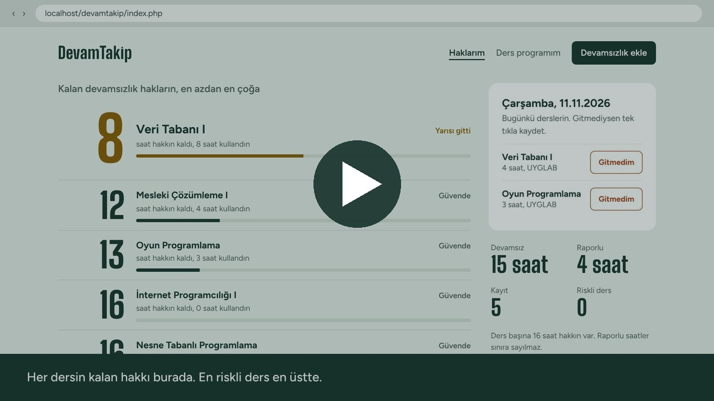

# DevamTakip – Devamsızlık Hak Takip Sistemi

**Ders:** İnternet Programcılığı I (PHP)
**Öğrenci:** Ahmet Hilmi Yücel – 254309056
**Sürüm:** 1.0 (ilk teslim, 8 Kasım 2026)

## Tanıtım videosu (30 sn)

[](docs/devamtakip_tanitim.mp4)

Videoyu izlemek için görsele tıklayın ya da [docs/devamtakip_tanitim.mp4](docs/devamtakip_tanitim.mp4) dosyasını açın.

## Projenin amacı

Öğrenciler çoğu zaman hangi dersten kaç saat devamsızlık yaptıklarını ve ne kadar hakları kaldığını takip edemiyor. Bu yüzden farkında olmadan devamsızlıktan kalabiliyorlar.

DevamTakip, kaçırılan dersleri kaydetmeyi ve her ders için kalan devamsızlık hakkını görmeyi sağlayan bir PHP uygulamasıdır. Okulun ders programı uygulamaya yüklü olduğu için öğrenci dersleri elle girmez; bölümünü seçip aldığı dersleri işaretler. Ana sayfada o günkü dersleri görür ve gitmediği dersi tek tıkla kaydedebilir.

## Özellikler

- **Ana sayfa:** Uygulamanın adı ve üst menü (Haklarım, Ders programım, Devamsızlık ekle).
- **Kalan haklar:** Her ders için kalan devamsızlık saati büyük rakamla gösterilir. En az hakkı kalan ders en üstte olacak şekilde sıralanır. Risk durumuna göre renk ve etiket değişir (Güvende, Yarısı gitti, Sınıra yakın, Sınır doldu).
- **Bugünkü dersler:** Bugünün gününe göre ders programından o günkü dersler listelenir. "Gitmedim" butonu dersi o günün tarihi ve ders saatiyle kaydeder.
- **Ders programı:** Okulun 2026-2027 Güz ders programındaki 10 bölümden biri seçilir, alınan dersler işaretlenir. "Sadece 2. sınıfı seç" bağlantısıyla bir sınıfın bütün dersleri tek tıkla işaretlenir. Alttan alınan dersler diğer sınıftan eklenebilir. Seçilen program haftalık tablo olarak gösterilir.
- **Kayıt listeleme:** Kayıtlar `foreach` döngüsüyle tablo halinde, tarihe göre yeniden eskiye listelenir. Her kayıtta ders, tarih, saat, durum ve not alanları bulunur.
- **Yeni kayıt ekleme:** HTML formu ile POST yöntemi kullanılarak kayıt eklenir.
- **Veri doğrulama (PHP tarafında):**
  - Ders seçilmeli ve kullanıcının ders programında olmalı.
  - Tarih boş olamaz, geçerli olmalı ve ileri bir tarih olamaz.
  - Saat 1 ile 8 arasında tam sayı olmalı.
  - Durum "Devamsız" veya "Raporlu" olmalı.
  - Not en fazla 150 karakter olabilir.
  - Aynı derse aynı tarih için ikinci kayıt girilemez.
  - Ders programı kaydedilirken en az bir ders seçilmeli ve dersler seçilen bölüme ait olmalı.
  - Hatalı alanların altında açıklayıcı mesaj gösterilir, girilen değerler kaybolmaz.
- **Kayıt silme:** Her satırdaki "Sil" butonu ile POST yöntemiyle silme (onay sorusu sorulur).
- **Filtreleme:** GET yöntemiyle derse ve/veya duruma göre filtreleme.
- **Özet sayaçlar:** Toplam kayıt, toplam devamsızlık saati, raporlu saat ve riskli ders sayısı.
- **Güvenli çıktı:** Kullanıcının girdiği tüm metinler `htmlspecialchars()` ile ekrana yazılır.
- **Kalıcılık:** Kayıtlar ve ders programı `$_SESSION` içinde tutulur, sayfa yenilense de kaybolmaz.
- **Mobil uyum:** Telefonda tek kolona geçer, "Bugün" paneli en üste çıkar.

### Kurallar (varsayımlar)
- Ders başına devamsızlık sınırı **16 saat** kabul edilmiştir (`functions.php` içindeki `DEVAMSIZLIK_SINIRI` sabiti).
- "Raporlu" kayıtlar listede görünür ama sınıra sayılmaz.
- İlk açılışta Bilgisayar Programcılığı 2. sınıf programı ve 5 örnek kayıt yüklüdür.

## Klasör yapısı

```
devamtakip/
├── index.php              Ana sayfa: kalan haklar, bugünkü dersler, sayaçlar, filtre ve kayıt listesi
├── ekle.php               Yeni kayıt formu ve form verisinin doğrulanıp eklenmesi
├── sil.php                Kayıt silme işlemi (sadece POST kabul eder)
├── program.php            Ders programı seçimi ve haftalık görünüm
├── functions.php          Sabitler ve kullanıcı tanımlı fonksiyonlar
├── header.php             Tüm sayfalarda ortak üst kısım ve menü
├── footer.php             Tüm sayfalarda ortak alt kısım
├── veri/
│   └── programlar.json    Okulun ders programı (10 bölüm, 1. ve 2. sınıf)
├── assets/
│   ├── style.css          Tasarım dosyası
│   ├── fonts.css          Font tanımları
│   └── fonts/             Projeye gömülü fontlar (internet olmadan da çalışır)
├── docs/                  Tanıtım videosu ve kapak görseli
└── README.md              Bu dosya
```

### Kullanıcı tanımlı fonksiyonlar (functions.php)

| Fonksiyon | Görevi |
|---|---|
| `programlariYukle()` | `programlar.json` dosyasını okuyup PHP dizisine çevirir |
| `bolumDersleri($programlar, $bolumAdi)` | Bir bölümün derslerini döndürür |
| `dersAdlari()` | Kullanıcının seçtiği derslerin adlarını verir |
| `gununDersleri($gun)` | Verilen gündeki dersleri ve saatlerini verir |
| `haftalikSaat($ders)` | Bir dersin haftalık toplam saatini hesaplar |
| `ornekKayitlar()` | İlk açılışta gösterilecek 5 örnek kaydı döndürür |
| `oturumuHazirla()` | Oturumda veri yoksa örnek kayıtları ve varsayılan programı yükler |
| `guvenli($metin)` | `htmlspecialchars()` ile metni güvenli hale getirir |
| `dersDevamsizligi($kayitlar, $ders)` | Bir dersteki toplam devamsızlık saatini hesaplar |
| `durumaGoreSaat($kayitlar, $durum)` | Bir durumdaki toplam saati hesaplar (sayaçlar için) |
| `riskSeviyesi($kullanilan)` | Kullanılan yüzdeye göre risk seviyesini belirler |
| `kayitlariFiltrele($kayitlar, $ders, $durum)` | Kayıtları derse/duruma göre filtreler |
| `tariheGoreSirala($kayitlar)` | Kayıtları tarihe göre sıralar |
| `tarihYaz($tarih)` | Tarihi gg.aa.yyyy biçiminde yazar |
| `kayitVarMi($kayitlar, $ders, $tarih)` | Aynı derse aynı gün kayıt olup olmadığını kontrol eder |

### Ders programı verisi

`veri/programlar.json`, Niksar MYO'nun yayımladığı "2026-2027 Güz Yarıyılı Ders Programı" PDF'inden bir kereye mahsus olarak (yapay zekâ yardımıyla yazılan küçük bir betikle) çıkarılmıştır. Her dersin kodu, adı, sınıfı, öğretim elemanı, dersliği ve hangi gün kaç saat olduğu bulunur:

```json
{ "kod": "BP203", "ad": "Veri Tabanı I", "sinif": 2, "hoca": "Öğr. Gör. Zuhal Koca",
  "derslik": "UYGLAB", "gunler": { "Çarşamba": 4 } }
```

Ders adlarındaki yazım hataları okulun PDF'indeki haliyle bırakılmıştır. Yeni dönemde sadece bu dosyanın değiştirilmesi yeterlidir.

## XAMPP üzerinde çalıştırma

1. XAMPP'i kurun ve **XAMPP Control Panel**'den **Apache**'yi başlatın.
2. Bu repoyu `C:\xampp\htdocs\devamtakip` klasörüne indirin (GitHub'da **Code → Download ZIP** ya da `git clone`).
3. Tarayıcıda `http://localhost/devamtakip/` adresini açın.
4. İlk açılışta Bilgisayar Programcılığı 2. sınıf programı ve 5 örnek kayıt görünür. Başka bir bölüm için "Ders programım" sayfasını kullanın. Örnek verilere dönmek için tarayıcıyı kapatıp açmak (oturumu sıfırlamak) yeterlidir.

Proje PHP 8 ile test edilmiştir. MySQL ve internet bağlantısı gerekmez.

## Bilinen eksikler

- Veriler `$_SESSION` içinde tutulduğu için tarayıcı kapatılınca kayıtlar ve seçilen program sıfırlanır. Sonraki aşamada MySQL'e taşınacak.
- Kayıt düzenleme (güncelleme) özelliği henüz yok.
- Kullanıcı girişi yok.
- Devamsızlık sınırı tüm dersler için aynı (16 saat).
- Resmi tatiller ve sınav haftaları dikkate alınmıyor; "Bugün" paneli sadece haftanın gününe bakıyor.

## Sonraki geliştirme planı

- MySQL + PDO ile kalıcı veri saklama (kayıtlar ve ders programı tabloları)
- Kayıt düzenleme
- Öğrenci girişi (her öğrenci kendi programını ve kayıtlarını görür)
- Ders bazında farklı devamsızlık sınırı
- Dönem sonu raporu (en çok devamsızlık yapılan dersler, haftalara göre dağılım)

## Yapay zekâ kullanımı

**Kullanılan araç:** Claude (Anthropic)

**Kullanım amaçları:**
- Proje fikrini belirlerken seçenekleri karşılaştırma
- PHP kodunun ilk taslağını oluşturma
- Veri doğrulama kurallarını ve hata mesajlarını belirleme
- Arayüz için farklı tasarım seçenekleri hazırlatma ve seçtiğim tasarımın CSS'ini yazdırma
- Okulun PDF ders programını JSON dosyasına dönüştürme
- Tanıtım videosunun hazırlanması (ekran görüntüleri ve altyazılar)
- Kodun nasıl çalıştığını açıklatma ve soru-cevaba hazırlanma

**Örnek istem (prompt):**
> "PHP ile devamsızlık takip sistemi yapmak istiyorum. Framework kullanmadan, veriler $_SESSION'da tutulsun. Kayıt ekleme ve silme POST ile, filtreleme GET ile olsun. Her ders için 16 saatlik sınıra göre kalan hakkı hesaplayan ve sınıra yaklaşınca uyarı veren bir ana sayfa olsun. Kodu sade yaz ve her bölümü açıklayan yorumlar ekle."

**Kendi katkım:**
- Proje konusunu kendi yaşadığım bir sorundan (devamsızlık hakkımı takip edememek) yola çıkarak seçtim.
- Ders programını elle girmenin zor olacağını fark edip okulun PDF programının kullanılması fikrini getirdim.
- Önerilen üç tasarım arasından seçim yaptım.
- Uygulamayı XAMPP üzerinde çalıştırıp farklı senaryolarla (boş form, hatalı saat, ileri tarih, aynı güne ikinci kayıt, HTML etiketi içeren not, silme, filtreleme, bölüm değiştirme) test ettim.
- Kodu inceleyip her dosyanın ve fonksiyonun görevini öğrendim.
